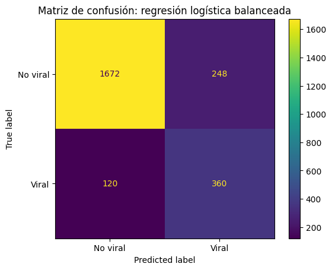

# Portafolio de IA
Proyectos de deep learning y machine learning de Jared Peralta Silva, estudiante de Ingeniería en Innovación Tecnológica (UABJO).

## 1. Red neuronal para clasificar círculos
Red neuronal en PyTorch que separa dos clases en forma de círculos concéntricos, un problema que una recta no puede resolver.

- **Arquitectura:** 2 entradas → 4 neuronas ocultas (sigmoide) → 1 salida, 17 parámetros
- **Entrenamiento:** BCELoss + Adam, 1000 épocas
- **Resultado:** pérdida de 0.715 a 0.0016 y 100 % de exactitud en entrenamiento

[Ver el notebook completo](RedNeuronalClasCirculos.ipynb)

## 2. ¿Será viral este video? (Machine learning clásico)

**Problema:** Predecir, antes de publicar un video de YouTube, si será viral. Definí "viral" como estar en el 20 % de videos con más vistas. Le serviría a un creador de contenido para decidir qué videos promocionar.

**Datos:** 12,000 videos de YouTube ([fuente del dataset]). Usé solo columnas que se conocen **antes** de publicar: categoría, duración, longitud del título, si la miniatura tiene una cara, hora y día de publicación, número de etiquetas, longitud de la descripción y suscriptores del canal. Excluí vistas, likes, comentarios y compartidos porque se miden después de publicar: usarlas sería fuga de datos.

**Proceso:**
1. Convertí categoría y día de publicación a columnas numéricas con one-hot encoding (29 columnas en total).
2. Separé los datos en 80 % entrenamiento y 20 % prueba, manteniendo la proporción de virales (stratify).
3. Estandaricé las columnas aprendiendo el promedio y la desviación solo del entrenamiento, para evitar fuga de datos.
4. Comparé contra un modelo base que siempre predice "no viral".
5. Entrené regresión logística (normal y balanceada) y árboles de decisión, y validé el mejor modelo con validación cruzada de 5 vueltas.

**Resultados (conjunto de prueba):**

| Modelo | Exactitud | Recall (virales encontrados) |
|---|---|---|
| Modelo base (siempre "no viral") | 80.0 % | 0 % |
| Regresión logística | 86.5 % | [tu resultado de la celda 8] |
| **Regresión logística balanceada** | **84.7 %** | **75.0 %** |
| Árbol de decisión (profundidad 5) | 78.8 % | 87.1 % |
| Árbol sin límite de profundidad | 79.2 % (100 % en entrenamiento) | — |

**Conclusión:** Elegí la regresión logística balanceada. Para un creador, perder un video viral es peor que una falsa alarma, y este modelo encuentra 3 de cada 4 virales manteniendo una exactitud mayor que el modelo base. La validación cruzada dio un recall estable (72 % ± 2.6 %), así que el resultado no depende de la suerte en la separación. El árbol sin límite memorizó los datos de entrenamiento (sobreajuste) y el árbol limitado encontró más virales, pero con demasiadas falsas alarmas.

**Limitaciones y mejoras:**
- `subscriber_count` tiene valores atípicos (canales de hasta 100 millones); aplicar un logaritmo podría mejorar el modelo.
- No sé si los suscriptores se midieron al publicar o después; si fue después, podría haber una fuga de datos pequeña.
- Probar modelos más potentes (Random Forest, Gradient Boosting) y agregar información del título con procesamiento de lenguaje.

[Ver el notebook completo](YoutubeDTA_Proyecto1)
