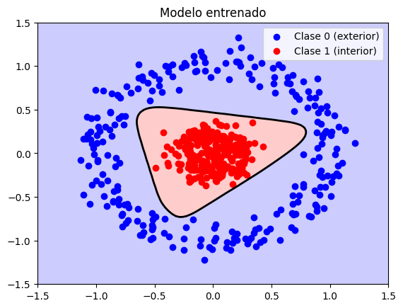

# Portafolio de IA
Proyectos de deep learning y machine learning de Jared Peralta Silva, estudiante de Ingeniería en Innovación Tecnológica (UABJO).

## 1. Red neuronal para clasificar círculos
Red neuronal en PyTorch que separa dos clases en forma de círculos concéntricos, un problema que una recta no puede resolver.

- **Arquitectura:** 2 entradas → 4 neuronas ocultas (sigmoide) → 1 salida, 17 parámetros
- **Entrenamiento:** BCELoss + Adam, 1000 épocas
- **Resultado:** pérdida de 0.715 a 0.0016 y 100 % de exactitud en entrenamiento

[Ver el notebook completo](RedNeuronalClasCirculos.ipynb)
